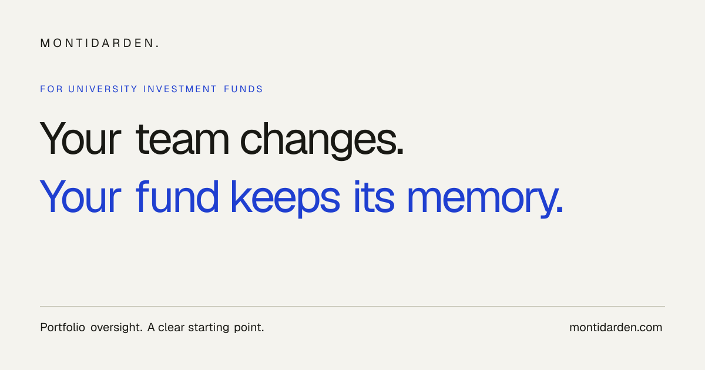

# Montidarden

Portfolio management software for investment teams.

[Visit Montidarden →](https://montidarden.com)

## Keep the fund's memory

Investment teams change. Their research, decisions and portfolio context should carry forward.

Montidarden brings portfolio oversight and investment work into one place, with university investment funds as its starting point.

- Fund dashboards, holdings, performance and portfolio analytics.
- Investment theses, research, notes and team workflows.
- Morning briefs and weekly recaps that keep teams informed.

## Project

**Status:** Live product, with continued development.

**Built with:** Next.js, React and TypeScript.

This repository presents the product. Application source and customer information remain private.

*The image is public-facing product artwork; it contains no customer portfolio data.*
