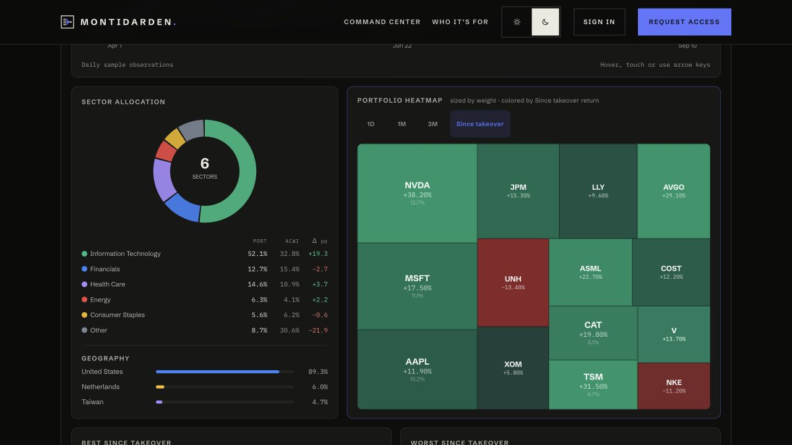
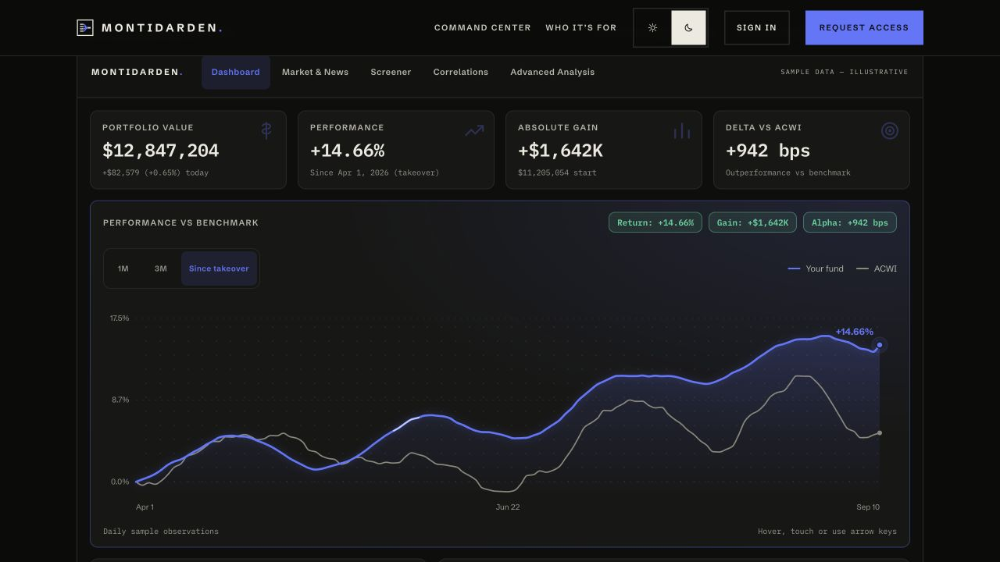

# Montidarden

Portfolio management software for investment teams.

[Visit Montidarden →](https://montidarden.com)

## Keep the fund's memory

Investment teams change. Their research, decisions and portfolio context should carry forward.

Montidarden brings portfolio oversight and investment work into one place for investment teams, family offices and student-managed funds.

- Fund dashboards, holdings, performance and portfolio analytics.
- Investment theses, research, notes and team workflows.
- Morning briefs and weekly recaps that keep teams informed.

## Project

**Status:** Live private beta. Access by invitation.

**Built with:** Next.js, React and TypeScript.

This repository presents the product. Application source and customer information remain private.

*The screenshots show the illustrative sample portfolio on Montidarden's public landing page. They contain no customer portfolio data.*
